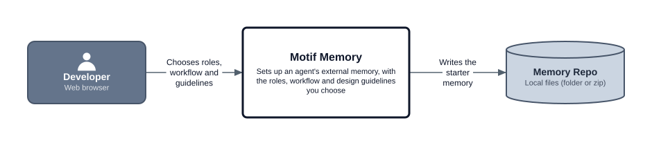
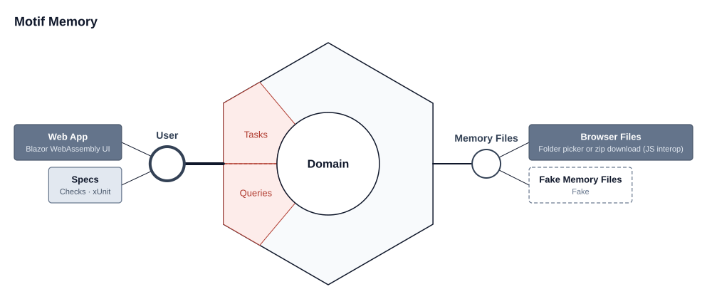

# Motif Memory

The next tool in the **[Motif.NET](https://github.com/motif-dotnet)** suite. It sets up an agent's external memory: a starter git repo of Markdown files, set out so an agent finds what it needs a level at a time. The memory grows as it's used, so the tool's job is the first version: the files, the structure and the roles that suit your way of working.

## The idea

- **The memory lives in a repo of its own.** Your `CLAUDE.md` (or another agent's instructions file) holds only a pointer to the memory's starting point. Everything else lives in the memory repo.
- **Progressively discoverable.** The starting point only routes, and every link says when to follow it, so an agent reads only what the task in hand needs, never the whole memory.
- **Three layers.** Your memory holds the roles, workflow and guidelines, plus a private note per repo for your own setup there. Each repo can also have a shared memory file in its `motif/` folder, for what anyone working on it needs.
- **Why not the agent's built-in memory?** A structure of your own choosing. It's portable across machines, readable by any agent rather than one, and in git, so you can review each change as a diff and see its history.
- **It grows as it's used.** A **Memory Auditor** role looks after it, and that's how lessons find their way in. Nothing changes without your OK.
- **The tool is mainly for setup.** It writes out the first version of the memory, and doubles as a catalogue for adding a role or pack later.

## What setup lets you choose

Every memory has a core: the starting point, a Memory Editor and a Memory Auditor. On top of that:

- **Roles** the agent can play, such as Feature Implementor, Code Reviewer or Bug Fixer. All are on by default. Each brings its stage in the workflow and the temporary docs it writes.
- **The workflow's order.** The stages come in a default order you can change, with a gentle warning if a stage would need a doc nothing earlier writes.
- **Design guidelines**, in packs such as General and C#, with single guidelines you can untick. Only what needs judgement: anything a formatter or analyser can enforce belongs in `.editorconfig`, which Motif Sketch's solution plan sets up.
- **When memory changes are committed**: once you've agreed them (the default), only when you ask, or by you.
- **Obsidian**, if you'd like to read the memory there.

At the end, the app shows the pointer to paste into each agent's instructions file. It writes nothing outside the memory folder.

## Design

A first draft, from the discussion so far.

### Context diagram

### Ports and adapters

These pictures are exported by [Motif Sketch](https://motif-dotnet.github.io/Motif.Sketch/) from [motif/sketch.motifsketch.json](motif/sketch.motifsketch.json). The [motif/](motif/) folder holds the design, the [solution plan](motif/plan.md) and the [glossary](motif/glossary.md), which is mostly *proposed* for now.

## Status

**Next up.** Designed, with the solution plan stubbed out but no functionality yet. The design comes from reviewing an example memory that grew through real use. The first content is written: the generic roles and guidelines, as Markdown in [Content/](Content/README.md). Next it gets used as a real memory on the Motif repos. The app gets built after that, around content that's been tried. The decisions and open questions are in [decisions.md](decisions.md).

## Files

| File | What it is |
|---|---|
| [Content/](Content/README.md) | The memory's roles, workflow and guidelines, as Markdown. With every option chosen, it's a complete memory |
| [decisions.md](decisions.md) | The decisions so far and why, and what's still open |
| [motif/](motif/README.md) | Motif Memory's own design, solution plan, diagrams and glossary |
| [AGENTS.md](AGENTS.md) | Where coding agents start |

## License

MIT, see [LICENSE](LICENSE).
